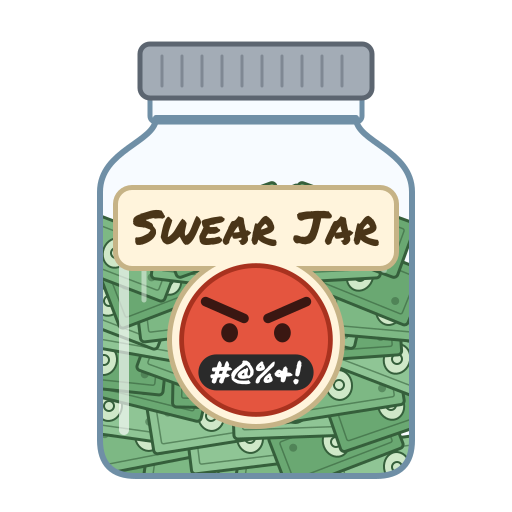

# swear-jar
a github contribution heatmap, but it's swears directed at claude

<p align="center"></p>

> [!CAUTION]
> This whole app is slop. I spent more time than is reasonable on this project, but none of it was looking at the code. Run it at your own risk.

## Usage

swear-jar reads your Claude Code transcripts from `~/.claude/projects` (or `$CLAUDE_CONFIG_DIR/projects` if that's set), counts the swears in the messages you typed, and renders a year-long heatmap. Tool output, pasted content, and system reminders don't count.

```sh
swear-jar --html swear-jar.html
swear-jar --svg out
swear-jar --svg out --profile-readme
swear-jar --html swear-jar.html --wordlist censored --svg out --json data.json
```

| Flag | What it does |
|------|--------------|
| `--html FILE` | Write a standalone HTML page. It follows your system's light or dark mode. Use `-` for stdout. |
| `--wordlist MODE` | Which words the `--html` page shows: `none` (the default; counts only), `censored`, or `uncensored`. Only valid with `--html`. |
| `--svg DIR` | Write `heatmap-light.svg` and `heatmap-dark.svg` into `DIR`, creating it if needed. SVGs never show any words. |
| `--profile-readme` | With `--svg`, also write `DIR/swear-jar.md`, a snippet for your GitHub profile README, and print how to use it. |
| `--json FILE` | Write the raw scraped counts as JSON. Use `-` for stdout. |
| `--version` | Print the version and exit. |

Any combination of `--html`, `--svg`, and `--json` can run at once, but only one output can go to stdout. Usage errors exit with code 2, and other failures with code 1.

### Showing it on your GitHub profile

1. Run `swear-jar --svg out --profile-readme`.
2. Copy `out/heatmap-light.svg` and `out/heatmap-dark.svg` into the root of your profile repository, the public repo named after your username (`github.com/USERNAME/USERNAME`).
3. Paste `out/swear-jar.md` into that repo's `README.md`. It shows whichever SVG matches the viewer's light or dark theme.
4. Commit and push. Rerun and push again whenever you want to update it.

## Custom swears

swear-jar ships with the obvious English swear words built in. To count your own words too, create a `.swears.json` file.

### Where swear-jar looks

1. `.swears.json` in the current directory.
2. `~/.swears.json` in your home directory, only if the first one doesn't exist.

The first file found is the only one used; the two are never merged. If neither exists, only the built-in words are counted.

### Format

The file is a JSON array. Each entry is either a plain string or an object.

```json
[
  "bunny",
  "red panda",
  {"word": "chinchilla"},
  {"word": "hedgehog", "censored": "h*dg*h*g"},
  {"word": "cat", "prefix": true, "suffix": false},
  {"word": "otter", "suffix": false},
  {"word": "wombat", "censored": "wombat"}
]
```

A plain string such as `"bunny"` is the same as `{"word": "bunny"}`, with every option at its default. [`.swears.example.json`](.swears.example.json) is a ready-to-copy starting point.

| Field | Default | What it does |
|-------|---------|--------------|
| `word` | required | The word or phrase to count. |
| `suffix` | `true` | Also count the word with letters after it, so `bunny` counts `bunnyhop`. Set it to `false` to count `otter` but not `otters`. |
| `prefix` | `false` | Also count the word with letters before it, so `cat` counts `bobcat` and `wildcat`. |
| `censored` | first vowel replaced with `*` | What to show when words are displayed censored. Set it to the word itself to never censor it. |

### How matching works

1. Matching is case-insensitive, so `Bunny`, `BUNNY`, and `bunny` all count as `bunny`.
2. Only whole words count. `cat` never matches inside `category`, because `suffix` would have to allow the trailing letters and `prefix` would have to allow any in front.
3. Each `suffix` and `prefix` only adds letters; it doesn't change spelling. `bunny` counts `bunnyhop` but not `bunnies`, so add `"bunnies"` as its own entry if you want both.
4. Phrases work: `"red panda"` counts the two words together.
5. Words are recorded as they appear in your messages, so `bunnyhop` and `bunny` show up separately in the vocabulary.

### How censoring works

1. By default the first vowel is replaced with `*`: `bunny` becomes `b*nny`, `otter` becomes `*tter`, and `red panda` becomes `r*d panda`.
2. In a longer match, only the entry's own word is censored: with `"cat", "prefix": true`, `bobcat` becomes `bobc*t`.
3. A word with no vowels, such as `pfft`, is shown as is.
4. `censored` replaces the default, and applies inside longer matches too: `hedgehogs` becomes `h*dg*h*gs`.
5. Setting `censored` to the word itself leaves it alone: `wombat` always shows as `wombat`, and `wombats` as `wombats`.

### Overriding a built-in word

Custom entries are checked before the built-in words, so an entry for a built-in word replaces its matching and censoring options.
